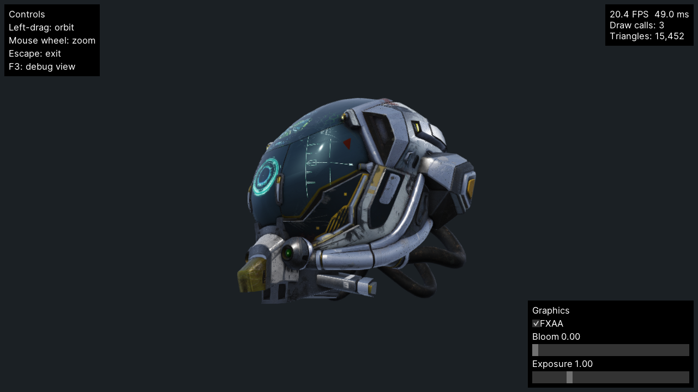
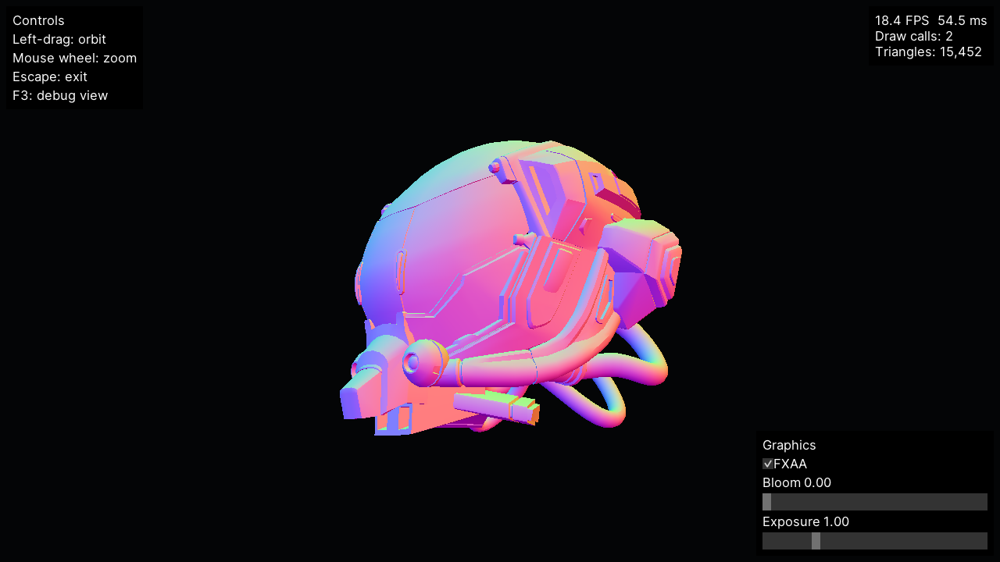
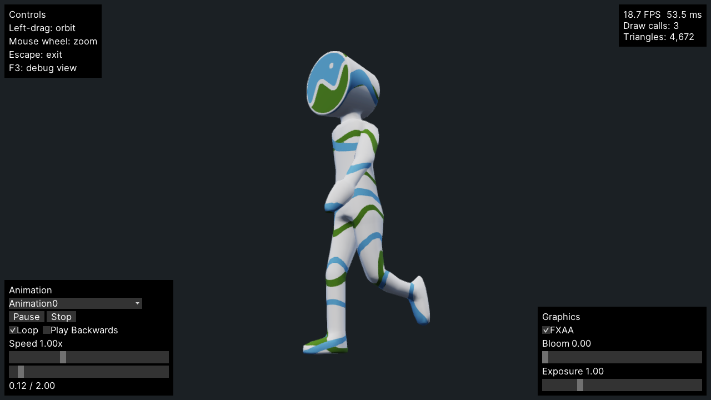

# Viewer

`DigitalRiseModel.Viewer` is a small MonoGame window viewer for glTF and GLB models. Its executable is `drm-viewer`, and it is also packaged as the `drm-viewer` .NET tool.



## Install and run

```bash
dotnet run --project DigitalRiseModel.Viewer -- "path/to/model.glb"
```

```bash
dotnet pack DigitalRiseModel.Viewer -c Release -o artifacts
dotnet tool install --global DigitalRiseModel.Viewer --add-source artifacts
drm-viewer "path/to/model.glb"
```

The viewer loads assets through `AssetManager.LoadDrModel`, so external buffers and textures resolve relative to the model file.

## Command-line options

- `--debug-view <name>` — start with a PBR debug view: `shaded`, `basecolor`, `metallic`, `roughness`, `normal`, `occlusion`, `emissive`, `diffuse`, `specular`, `ibldiffuse` or `iblspecular`.
- `--exposure <value>` — set the shaded-output exposure scale.
- `--bloom <intensity>` — add HDR bloom before tone mapping; `0` disables it.
- `--fxaa` / `--no-fxaa` — enable or disable FXAA (enabled by default).
- `--screenshot <file>` — render a few frames, save a PNG and exit.

For example, to inspect the normals of a model:

```bash
drm-viewer "path/to/model.glb" --debug-view normal
```



`--debug-view` and `--screenshot` are useful together for checking a model channel by channel without opening a window.

## Controls

- Left-drag: orbit the camera.
- Mouse wheel: zoom.
- Escape: exit.
- `F3`: cycle PBR debug views and update the window title.

Camera orbit and zoom are ignored while the mouse is over a UI panel.

## What you are looking at

The viewer always renders through the custom PBR path. It combines a fixed three-point studio light rig with image-based lighting generated at startup from a procedural environment, renders to an HDR scene target and resolves it with exposure, ACES tone mapping and gamma.

Three panels overlay the scene:

- Top left: camera and exit hints.
- Top right: smoothed FPS, frame time, draw calls (including post-processing) and triangle count.
- Bottom right: FXAA, bloom and exposure, initialized from `--fxaa`/`--no-fxaa`, `--bloom` and `--exposure`.

## Animation panel

The animation panel appears only when the model has animations. It selects a clip, plays/pauses/stops playback, seeks through the current clip, toggles looping and reverse playback, and adjusts playback speed.



Animated models start with their first clip selected and playing automatically.

## Supported features and limitations

Supported:

- Core metallic-roughness materials with base color, metallic-roughness, normal, occlusion and emissive maps.
- Vertex colors, alpha opaque/mask/blend, double-sided materials and skinning.
- UV0/UV1 selection and sampler wrap/filter settings.
- `KHR_materials_emissive_strength`, `KHR_texture_transform` and `KHR_materials_unlit`.

Not implemented:

- `KHR_lights_punctual`, clearcoat/sheen/transmission, Basis Universal textures, Draco compression and morph targets. Clearcoat/sheen/transmission are deferred to a separate milestone.
- Normal maps require authored `TANGENT` attributes; tangent generation is not implemented.
- Shadows and HDR environment loading are not available.
- Transparent parts are sorted per part; skinned parts are not frustum-culled.

## Related

- `Samples/SimpleViewer` is a stock-effect reference viewer built from the same code.
- `Samples/PrimitivesDemo` shows the primitives without any asset files.
